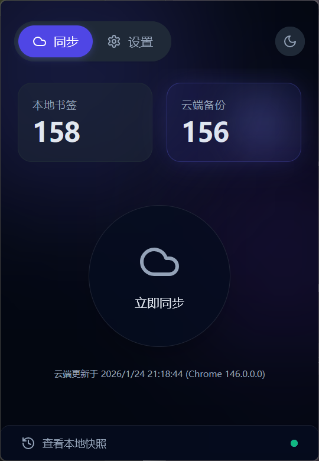
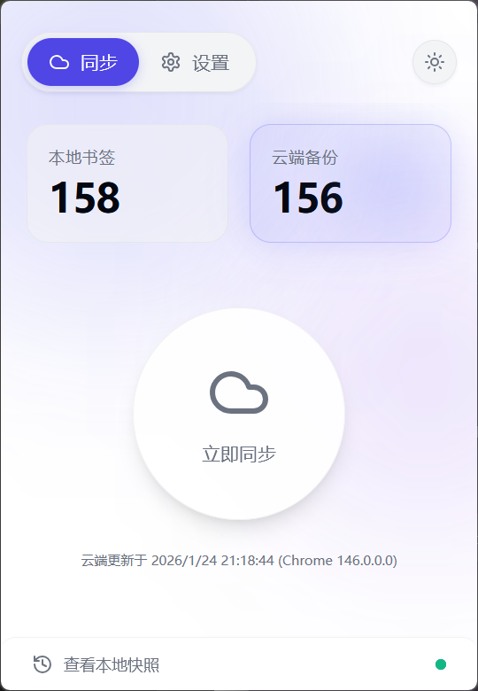

<p align="center">
  
</p>

<h1 align="center">Bookmark Syncer</h1>

<p align="center">
  Cross-browser bookmark sync tool with self-hosted WebDAV solution.
</p>

<p align="center">
  <a href="https://github.com/Yueby/bookmark-syncer/releases/latest">
    
  </a>
  <a href="https://github.com/Yueby/bookmark-syncer/releases/latest">
    
  </a>
  <a href="./LICENSE">
    
  </a>
</p>

<p align="center">
  <a href="./README.md">简体中文</a>
</p>

---

### 📸 Preview

|              Dark Mode               |               Light Mode               |
| :----------------------------------: | :------------------------------------: |
|  |  |

### ✨ Features

- 🔒 **Self-Hosted** - Store bookmarks on your own WebDAV server
- 🌐 **Cross-Browser** - Supports Chrome, Edge, Firefox and more
- 🔄 **Smart Sync** - Incremental sync, only transfers changes
- 📱 **Auto Sync** - Automatically uploads when bookmarks change
- ⏰ **Scheduled Sync** - Periodically checks for cloud updates
- 📦 **Local Snapshots** - Auto backup before sync, one-click restore

### 📦 Installation

#### Chrome / Edge

1. Download the latest `chrome-extension.zip`
2. Extract to a local folder
3. Open `chrome://extensions/`
4. Enable "Developer mode"
5. Click "Load unpacked"
6. Select the extracted folder

#### Firefox

1. Download the latest `firefox-extension.zip`
2. Open `about:debugging#/runtime/this-firefox`
3. Click "Load Temporary Add-on"
4. Select the zip file

### ⚙️ Usage

1. Click the extension icon to open the panel
2. Go to "Settings" → "WebDAV Configuration"
3. Enter your WebDAV server details
4. Click "Save and Test Connection"
5. Return to home and click "Sync"

#### Readable HTML bookmark copy

Enable “Sync readable HTML copy” in “Settings → Sync Settings” (off by default), then run a sync to create `BookmarkSyncer/bookmark.html` on WebDAV. The page provides collapsible folders and a mobile-friendly layout. Sync checks and repairs missing or stale copies even when bookmarks are unchanged, and skips the HTML upload if the page already matches.

- Download and open the file in a browser. Direct browsing through a server URL depends on your WebDAV service's authentication and file-serving policies.
- This is a read-only browsing copy, not a replacement for compressed backups, a browser bookmark import file, or two-way sync.
- The setting is per device; enable it on each device that should publish the copy. An overwrite pull also refreshes it. Local additions from a merge pull are published only after uploading the merged bookmarks.
- HTML refresh failures are reported and retried on subsequent syncs without failing an already completed backup or restore.
- Concurrent devices can temporarily leave the copy behind. After concurrent writes stop, a subsequent sync from an enabled device whose bookmarks match the cloud can repair it. Without a later sync, the copy is not guaranteed to be current.
- HTML contains plain-text bookmark titles and URLs and uses the WebDAV directory's existing access permissions. Disabling the setting stops updates from that device; it does not delete the existing file or stop other enabled devices from updating it.

### 🛠️ Development

Use Node.js 22.12+ and pnpm 10.26.2. Shared WXT entrypoints and configuration live in `apps/extension`; application code remains in `packages/app`.

```bash
# Install dependencies
pnpm install

# Automatically open an isolated test browser with the extension and hot reload
pnpm dev         # Chrome (same as pnpm dev:chrome)
pnpm dev:firefox # Firefox

# Type checking and unit tests
pnpm typecheck
pnpm test

# Build both browsers
pnpm build

# Package Chrome and sign Firefox
pnpm package
```

Install the corresponding browser first. Dev browsers use independent profiles in `apps/extension/.dev-profiles/`, preserving test bookmarks, extension settings, and login state across restarts without using your everyday browser data. Open Bookmark Syncer from the browser's extensions menu. Add test bookmarks and configure a test WebDAV account before testing; overwrite pulls affect only the test browser.

Development outputs are `apps/extension/.output/chrome-mv3-dev` and `firefox-mv3-dev`; production outputs are `chrome-mv3` and `firefox-mv3` in the same directory. Chrome packaging creates `apps/extension/.output/chrome-extension.zip`. Firefox signing still uses `WEB_EXT_API_KEY` and `WEB_EXT_API_SECRET` environment variables and writes signed artifacts to `.output`. Profiles and generated outputs are excluded from Git.

### 🤝 Contributors

Thanks to everyone who contributes code, feedback, and ideas.

- [@Ancientwood](https://github.com/Ancientwood) — Readable HTML bookmark copy feature ([#14](https://github.com/Yueby/bookmark-syncer/pull/14)).

### 📄 License

[GNU AGPLv3](./LICENSE) - Open Source
